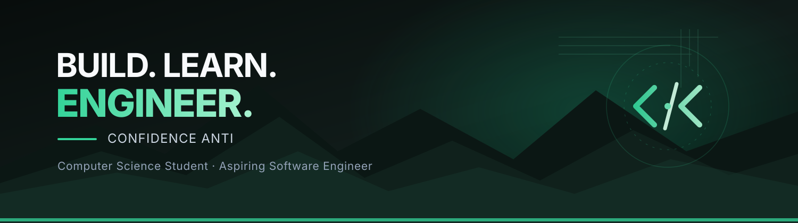

<!--
  Confidence Anti | GitHub Profile
  Keep this README accurate: describe work in progress as work in progress.
-->

  

   

  

    <strong>Computer Science Student</strong> &nbsp;·&nbsp;
    <strong>Aspiring Software Engineer</strong>
  

  

    Interested in software engineering, backend development, system design,
    and building reliable software that solves real problems.
  

  
  

---

## About

I'm a Computer Science student working towards becoming a well-rounded software engineer. I enjoy understanding how software systems fit together, learning sound engineering practices, and turning ideas into working projects.

- Building practical projects while strengthening my engineering fundamentals.
- Developing my skills in TypeScript, Java, backend development, and databases.
- Learning more about software architecture, maintainability, and scalable systems.
- Interested in collaborating, sharing knowledge, and learning from other developers.

## Featured work

### SANKOVIA StudyMate
*Private · In active development*

An academic learning platform being developed with a focus on institution-aware learning experiences and responsible access to academic information.

Current engineering work includes foundations for authentication, institution membership and authorization, academic data modelling, and document-processing workflows. The platform is still being built; this is not a claim that the complete product or all planned AI features are finished.

## Technologies & tools

  

## Current learning focus

- **Software engineering:** clean code, modular design, testing, and maintainability.
- **Backend development:** APIs, authentication, authorization, and data modelling.
- **Databases:** relational design, PostgreSQL, and Prisma.
- **Systems thinking:** architecture, multi-tenant applications, and scalable design.

## Find me on GitHub

  <a href="https://github.com/rsconfidence?tab=repositories">Repositories</a>
  &nbsp;·&nbsp;
  <a href="https://github.com/rsconfidence?tab=projects">Projects</a>
  &nbsp;·&nbsp;
  <a href="https://github.com/rsconfidence?tab=overview">Activity</a>

---

  Building today. Engineering tomorrow.

